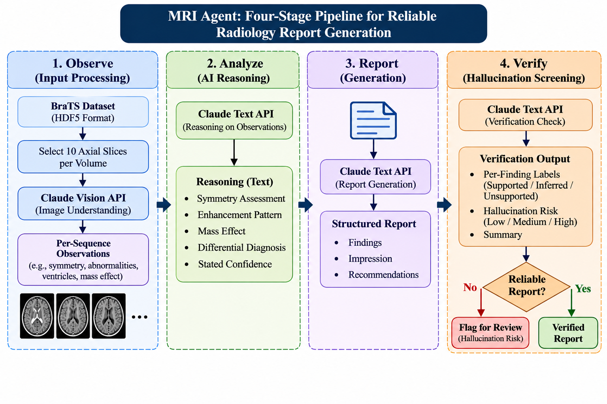

# Observe, Analyze, Report, Verify

### An Agentic Multimodal Pipeline for Brain MRI Report Generation with Built-In Hallucination Screening

AI-powered brain tumor radiology report generation using Claude (Anthropic) and the BraTS 2020 dataset. This repository is the code for the manuscript of the same title, currently under review at *Healthcare Informatics Research* (HIR).

## Overview

Large language models draft fluent clinical text, but hallucination remains a barrier to radiology reporting. This project separates brain MRI report generation into four stages — **observe, analyze, report, verify** — so that unsupported claims can be audited rather than hidden inside one generation call. The system is evaluated against a 100%-image-blind trivial baseline, a classical non-AI (FLAIR-threshold) baseline on identical images, and a 9-case non-radiologist author review, with 95% bootstrap confidence intervals throughout.

The headline finding: the verification step reliably catches internal self-contradictions, but not systematic errors that are consistent across all four stages — the system's laterality (left/right) and tumor-burden calls underperform a simple, non-learned image-threshold baseline on the same cases. This is a feasibility study for self-auditing report generation, not a validated diagnostic tool.

## Pipeline

The pipeline issues four sequential calls to the same underlying model, Claude Opus 4.5 (Anthropic), accessed via the Anthropic API and used as a general-purpose vision-and-text model with no fine-tuning or retrieval.



1. **Observe** — describes symmetry, signal abnormalities, ventricles, mass effect, and enhancement, sequence by sequence (FLAIR, T1, T1ce, T2), with an explicit instruction not to diagnose or invent findings.
2. **Analyze** — reasons only from the Step-1 text: symmetry, enhancement pattern, mass effect, and a differential diagnosis.
3. **Report** — renders that reasoning into a fixed clinical report template.
4. **Verify** — re-reads the generated report against the Step-1 observations only, labels each finding as supported/inferred/unsupported, and emits a hallucination-risk rating (low/medium/high).

## Dataset and baselines

- **Data:** 106 volumes from the public, de-identified [BraTS 2020](https://www.kaggle.com/datasets/awsaf49/brats20-dataset-training-validation) brain tumor segmentation benchmark (four co-registered MRI sequences per case; ten evenly spaced slices from the middle 50% of each volume). Ground-truth tumor presence, burden, and laterality are derived directly from the BraTS pixel masks.
- **Trivial baseline:** always reports "no tumor," image-blind. Since the sample is 100% tumor-positive by construction, its precision/recall/F1 are exactly zero — confirming the sample grants no free positive-detection credit.
- **Threshold baseline:** a classical, non-learned image heuristic with no clinical knowledge — pixels more than 2 SD above the brain-masked mean FLAIR intensity are flagged as hyperintense, and tumor presence/laterality/burden are computed from that mask with the same rule used for ground truth.

## Results

Evaluated on 106 BraTS 2020 volumes, with 95% bootstrap confidence intervals.

**Headline metrics**

| Metric | System | Trivial baseline | Threshold baseline |
|--------|--------|-------------------|---------------------|
| Tumor accuracy/precision/recall/F1 | 1.00 [1.00, 1.00] | 0.00 | 1.00 [1.00, 1.00] |
| Report quality (0-1) | 0.992 [0.980, 1.00] | 0.667 | - |
| Laterality, exact match | 0.293 [0.208, 0.377] | - | 0.745 [0.660, 0.821] |
| Laterality, soft match | 0.443 [0.368, 0.524] | - | 0.868 [0.826, 0.910] |

The accuracy/precision/recall/F1 numbers look perfect only because every case in this sample has a tumor present — a trivial baseline that always guesses "tumor" scores identically on those metrics. Laterality is the more informative result: the system got the exact opposite side from ground truth on 49.4% of unilateral cases, versus 1.1% for the threshold baseline, indicating a systematic left-right bias rather than noise. The system also predicted "large" tumor burden in all 106 cases regardless of ground truth.

**Hallucination-risk classification (106 cases)**

| Risk level | Count (%) |
|---|---|
| Low | 100 (94.3) |
| Medium | 6 (5.7) |
| High | 0 (0.0) |
| Unclassified | 0 (0.0) |

5.7% of cases (CI 1.9–10.4) were flagged, each for a specific, identifiable unsupported claim — the exact failure mode the Verify step is designed to catch. No case had its laterality or burden error flagged, because those errors, once made in Step 1, are carried consistently through Steps 2–3 and never contradict the report's own stated observations; Verify audits internal consistency, not ground truth.

**Author-conducted structured review (n=9)**

| Measure | Score [95% CI] |
|---|---|
| Mean accuracy (1-5) | 2.78 [2.33, 3.33] |
| Mean completeness (1-5) | 3.89 [3.67, 4.00] |
| Mean clinical usefulness (1-5) | 2.56 [2.22, 2.89] |
| Would use as draft | 0.0% [0.0, 0.0] |

No licensed radiologist was available; this review was conducted by the first author (a graduate student, not a clinician) on a 9-case subset flagged for medium hallucination risk or sampled during debugging, using the Gradio app (`app.py`) to view MRI slices, the ground-truth overlay, and the generated report side by side.

## Conclusion

The system achieves high report quality and a hallucination-screening step that reliably catches internally inconsistent claims, but its laterality and tumor-burden sub-tasks underperform a simple, non-learned image-threshold baseline evaluated on identical cases, and the author review judged no report draft-ready. This unflattering comparison is reported deliberately: it isolates where self-verification adds value (catching self-contradiction) from where it cannot (catching errors consistent across all four stages), and points to burden calibration and laterality convention as the most tractable next fixes.

## Project structure

- `mri_pipeline.py` — data extraction and preprocessing from BraTS HDF5 volumes
- `mri_agent.py` — the four-stage Observe/Analyze/Report/Verify agentic pipeline
- `evaluate_reports.py` — accuracy, quality, laterality, and burden evaluation against both baselines, with bootstrap CIs
- `apply_verification.py` / `reverify_only.py` — run or re-run the Verify step over existing outputs
- `make_prompts.py` — prompt construction helpers
- `fix_hallucination_risk.py` — hallucination-risk label post-processing
- `peek.py` / `peek_volume1.py` — quick data/volume inspection utilities
- `app.py` — Gradio web UI (localhost:7860) used for the author-conducted review

## Setup

1. Install dependencies:
   ```
   pip install anthropic numpy pillow h5py tqdm matplotlib gradio rouge-score
   ```
2. Set your API key:
   ```
   export ANTHROPIC_API_KEY="your-key-here"
   ```
3. Run in order:
   ```
   python mri_pipeline.py
   python mri_agent.py
   python evaluate_reports.py
   python app.py
   ```

## Tech stack

- Claude Opus 4.5 (Anthropic) — vision + language model, accessed via the Anthropic API
- BraTS 2020 — brain tumor MRI benchmark dataset
- Python — h5py, NumPy, Pillow, Gradio
- Gradio — web UI for case review

## Data/code availability and ethics

This study uses the public, de-identified BraTS 2020 dataset; no new human-subjects data were collected and no IRB approval was required. The de-identified public release does not include per-case patient age or sex, so subject demographics cannot be reported.

## AI use disclosure

Generative AI was used in two distinct capacities in this project. First, a general-purpose large language model (Claude Opus 4.5, Anthropic) is the system under study — its use and evaluation are the research contribution itself, not an undisclosed writing aid. Second, an AI coding assistant (Claude, Anthropic, via Claude Code) was used to help implement the evaluation harness and statistical-analysis code; all code, analyses, and content were reviewed and approved by the authors.

## Authors

- Sobia Arshad — Department of Anti-Aging Healthcare, Inje University
- Yongcheol Kim, Ph.D. — Department of AI and Software, Inje University (corresponding author)
- Sonali Gangwar — Department of Computer Engineering, Inje University
- Md Ariful Islam Mozumder, Ph.D. — Department of Digital Anti-Aging Healthcare, Inje University

## Disclaimer

This is a research prototype and a feasibility demonstration, not a validated diagnostic tool. All outputs must be verified by a qualified radiologist before any clinical use.

## License

MIT — see [LICENSE](LICENSE).
